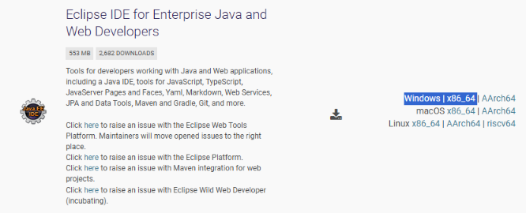
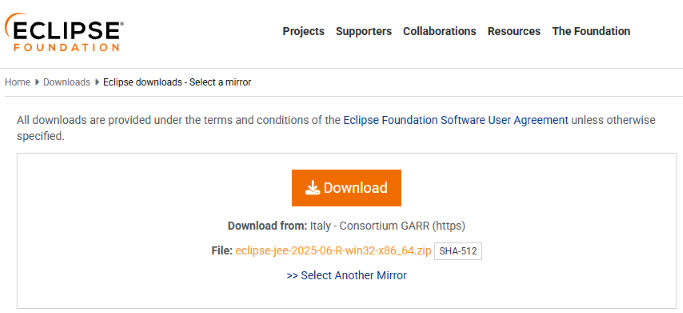
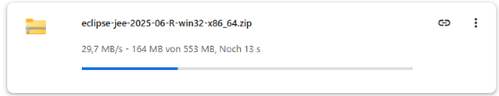

# Eclipse Modeling Tools for BW/4HANA bundle builder

This project builds Eclipse including the [Modeling Tools for BW/4HANA plugin](https://tools.hana.ondemand.com/#bw). The result is a portable version of Eclipse including the modelling tools. This portable Version can be used by SAP developers to run their own Eclipse version from a folder, USB drive, or by Citrix admins to provide the modeling tools in a Citrix environment.

## Current Eclipse release


## Build

The short version to get your version of Eclipse + Modeling Tools for BW/4HANA:

```sh
npm i
npm start
```

The resulting zip file eclipse-dist.zip in the folder ./dist is your (portable) Eclipse + MTBW.

## Use case

SAP BW consultants need as an IDE Eclipse with the SAP modeling tools for BW/4HANA. The installation of an Eclipse with the modeling tools is, however, a manual task, often outsourced to the consultant: In managed scenarios, including Citrix, this often results in outdated version of the tooling. While Eclipse can be used to update the modeling tools automatically, this often does not work due to proxy restrictions, specially in Citrix environments.

### Solution

The goal of this project is provide a tool that builds a bundle of the Modeling Tools for BW/4HANA bundle on top of Eclipse. This reduces the amount of manual work and allows companies to ship the latest version fast to their SAP BW consultants.

## Target platform

The target platform of the bundle is: Windows

## Pre-requisites

To be able to use this project to build a Modeling Tools for BW/4HANA bundle, the latest LTS release from Node.js should be used. As the build is for Windows, a node version manager (nvm) is recommended to install Node.js. Here are some information on how to install Node.js on Windows:

- https://learn.microsoft.com/de-de/windows/dev-environment/javascript/nodejs-on-windows
- https://github.com/coreybutler/nvm-windows#installation--upgrades

## Build information

The target is a Windows version of Eclipse and Modeling Tools for BW/4HANA. Therefore, a Windows computer is required to run the build. The build is done by the Eclipse P2 Director. An Eclipse version is used as the foundation for the build.

- [P2 Director](https://help.eclipse.org/latest/index.jsp?topic=%2Forg.eclipse.platform.doc.isv%2Fguide%2Fp2_director.html)
- [Eclipse Download](https://www.eclipse.org/downloads/packages/)

The build is done by running a set of [GruntJS](https://www.gruntjs.com) plugins. The starting point of the build process is the downloaded Eclipse ZIP. As Eclipse is not offering a default download URL to get the latest version, the URL needs to be provided manually.

An example URL:

https://ftp.halifax.rwth-aachen.de/eclipse/technology/epp/downloads/release/2026-03/R/eclipse-jee-2026-03-R-win32-x86_64.zip

From the [download page of Eclipse](https://www.eclipse.org/downloads/packages/) select the Java package.



Click on download and the extract the URL of the file from the download history / URL.





## Configuration

### Eclipse

The Eclipse download URL needs to be added as a parameter to the download task in the file Gruntfile.ks

```json
downloadfile: {
  options: {
    dest: './downloads',
    overwriteEverytime: true
  },
  files: {
    'eclipse.zip': 'https://ftp.halifax.rwth-aachen.de/eclipse/technology/epp/downloads/release/2026-03/R/eclipse-jee-2026-03-R-win32-x86_64.zip'
  }
},
```

### Plugins

The build will only add the Modeling Tools for BW/4HANA plugins. The features to be installed are povided in the exec parameter:

```json
exec: {
  eclipse: {
    command: 'build\\eclipse\\eclipse.exe -application org.eclipse.equinox.p2.director -repository https://download.eclipse.org/releases/2026-03,https://tools.hana.ondemand.com/2026-03 -installIU com.sap.bw.feature.bpcplanning.devedition.feature.group,com.sap.bw.feature.cloud.devedition.feature.group,com.sap.bw.feature.workbench.devedition.feature.group,com.sap.bw.feature.query.devedition.feature.group,com.sap.bw.feature.utilities.devedition.feature.group -tag AddMTBW -destination .\\build\\eclipse -profile epp.package.jee',
    stdout: true,
    stderr: true
  },
},
```

## Run build

The build is started by running:

```sh
npm i
npm start
```

The resulting file eclipse-dist.zip is stored in the folder dist.

## Detailed build information

The MTBW bundle is created using the [Eclipse P2 Director application](https://help.eclipse.org/latest/index.jsp?topic=%2Forg.eclipse.platform.doc.isv%2Fguide%2Fp2_director.html). A latest Eclipse (Java Bundle) is used as the source for building the bundle.

Eclipse Downloads: https://www.eclipse.org/downloads/packages/

URL for Eclipse JEE: [Mirror 1045](https://www.eclipse.org/downloads/download.php?file=/technology/epp/downloads/release/2026-03/R/eclipse-jee-2026-03-R-win32-x86_64.zip&mirror_id=1045)

### Eclipse installation

- Eclipse Update site: 2026-03 - https://download.eclipse.org/releases/2026-03
- Update site Modeling Tools for BW/4HANA https://tools.hana.ondemand.com/2026-03

### Modeling Tools for BW/4HANA feature IDs

The following Modeling Tools for BW/4HANA tools / features will be installed:

- BPC Embedded Planning (Developer Edition): com.sap.bw.feature.bpcplanning.devedition.feature.group
- BW Cloud Connectivity (Developer Edition): com.sap.bw.feature.cloud.devedition.feature.group
- BW Modeling Workbench (Developer Edition): com.sap.bw.feature.workbench.devedition.feature.group
- BW Query Designer (Developer Edition): com.sap.bw.feature.query.devedition.feature.group
- BW Utilities (Developer Edition): com.sap.bw.feature.utilities.devedition.feature.group

The command to run Eclipse and install the tools is not run by GruntJS. Npm will run the command in a shell. This is because running the command from GruntJS resulted in performance problems or even crashed.

## Run individual build steps

The build runs several Grunt tasks.

```json
grunt.registerTask('1', ['clean:all']);
grunt.registerTask('2', ['mkdir:build']);
grunt.registerTask('3', ['downloadfile']);
grunt.registerTask('4', ['unzip']);
grunt.registerTask('5', ['zip']);
grunt.registerTask('6', ['clean:build']);
```

You can run them individually. Either by running npx grunt [[taskid]] like npx grunt 1 or using npm. Please note that Grunt is _not_ used to run the Eclipse packaging step. The shell is used for this.

```sh
npm run clean
npm run prepare
npm run download
npm run unzip
npm run shell
npm run zip
npm run cleanup
```

## Standalone command

Running the complete build process is not necessary. Given that an Eclipse version is available, the P2 director application can be run separately. The command used to add Modeling Tools for BW/4HANA to the Eclipse installation is given here. This is the same command used by the npm task.

p2 Director Application: **eclipsec.exe**

Command:

```sh
build\eclipse\eclipsec.exe -application org.eclipse.equinox.p2.director -repository https://download.eclipse.org/releases/2026-03,https://tools.hana.ondemand.com/2026-03 -installIU com.sap.bw.feature.bpcplanning.devedition.feature.group,com.sap.bw.feature.cloud.devedition.feature.group,com.sap.bw.feature.workbench.devedition.feature.group,com.sap.bw.feature.query.devedition.feature.group,com.sap.bw.feature.utilities.devedition.feature.group -tag AddMTBW -destination .\\build\\eclipse -profile epp.package.jee -destination .\\build\\eclipse -profile epp.package.jee
```
